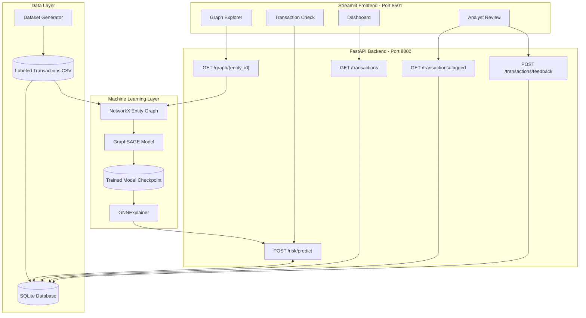

# GraphShield: Graph-Based Fraud Detection System

**Smart India Hackathon 2026 — SIH26199**  
**Team:** GraphSentinelz

GraphShield is an AI-powered financial fraud detection system that uses Graph Neural Networks (GNNs) to identify suspicious transaction patterns, connected accounts, shared devices, common IP addresses, and potential coordinated fraud rings.

Unlike traditional fraud detection systems that evaluate transactions individually, GraphShield models relationships between multiple entities using a heterogeneous entity-relationship graph. It uses a GraphSAGE-based architecture built with PyTorch Geometric and provides explainability through GNNExplainer.

The system combines a FastAPI backend, SQLite database, and Streamlit dashboard to demonstrate transaction risk scoring, interactive graph exploration, and analyst feedback workflows.

> **Project status:** Hackathon prototype. Synthetic data is used for demonstration. Production deployment requires validation on representative real-world data, security testing, and integration with actual payment infrastructure.

---

## Table of Contents

- [Key Features](#key-features)
- [Three-Tier Risk Classification](#three-tier-risk-classification)
- [System Architecture](#system-architecture)
- [Technology Stack](#technology-stack)
- [Project Structure](#project-structure)
- [Prerequisites](#prerequisites)
- [Installation](#installation)
- [Generate the Dataset](#generate-the-dataset)
- [Train the GraphSAGE Model](#train-the-graphsage-model)
- [Run GraphShield](#run-graphshield)
- [API Endpoints](#api-endpoints)
- [Dashboard Modules](#dashboard-modules)
- [How Fraud Detection Works](#how-fraud-detection-works)
- [Explainable AI](#explainable-ai)
- [Testing the System](#testing-the-system)
- [Limitations and Future Improvements](#limitations-and-future-improvements)
- [Team](#team)
- [License](#license)

---

## Key Features

- **Graph-based fraud detection:** Represents relationships among accounts, transactions, devices, IP addresses, merchants, and payment methods.
- **GraphSAGE model:** Learns from graph neighborhoods to classify suspicious transaction patterns.
- **Fraud ring identification:** Helps investigate multiple accounts connected through shared devices, IP addresses, or other entities.
- **Three-tier risk classification:** Categorizes transactions as `FRAUD`, `MID_LEVEL`, or `GENUINE`.
- **Explainable AI:** Uses GNNExplainer to investigate which graph features or connections influence model predictions.
- **REST API:** Provides endpoints for risk prediction, transaction retrieval, flagged alerts, feedback, and graph exploration.
- **Interactive dashboard:** Displays risk distributions, key performance indicators, recent transactions, and sector-level summaries.
- **Graph visualization:** Uses Pyvis to visualize relationships among connected entities.
- **Analyst review workflow:** Supports reviewing alerts and recording investigation outcomes.
- **Local development:** Uses SQLite to simplify setup without requiring a separate database server.

## Three-Tier Risk Classification

GraphShield uses configurable risk-score thresholds to categorize transactions.

| Decision tier | Risk score | Intended action |
|---|---:|---|
| `FRAUD` | 0.70–1.00 | High risk: block or hold and trigger an alert |
| `MID_LEVEL` | 0.30–less than 0.70 | Medium risk: step-up verification or analyst review |
| `GENUINE` | Less than 0.30 | Low risk: allow, subject to other security controls |

The decision rules are:

```python
def classify_risk(risk_score: float) -> str:
    if risk_score >= 0.70:
        return "FRAUD"
    elif risk_score >= 0.30:
        return "MID_LEVEL"
    return "GENUINE"
```

The function assumes `risk_score` is a valid number between `0.0` and `1.0`. Production code should validate the input and reject invalid scores.

**Important:** These thresholds are prototype configuration values, not universal fraud standards. A production payment system should calibrate them against validation data, false-positive rates, fraud losses, and operational requirements. Actual transaction blocking must only be enabled after suitable testing and safeguards.

## System Architecture



### Architecture Overview

1. **Data generation:** Creates a synthetic transaction dataset with labeled examples and simulated fraud rings.
2. **Graph construction:** Converts transactions and related entities into a graph using NetworkX.
3. **Model training:** Prepares graph features and trains a GraphSAGE classifier using PyTorch Geometric.
4. **Risk inference:** Evaluates a transaction using the trained model and converts its score into a risk tier.
5. **Persistence:** Stores transaction predictions and relevant investigation records in SQLite.
6. **Explainability:** Generates supporting model explanations where the configured GNNExplainer implementation supports them.
7. **Visualization:** Displays analytics, graph relationships, and alerts in a Streamlit interface.
8. **Analyst feedback:** Records review outcomes for auditing and potential future model improvement.

The diagram describes the intended data flow. Actual behavior depends on the implementation of each module.

## Technology Stack

| Component | Technology |
|---|---|
| Programming language | Python |
| Graph representation | NetworkX |
| Graph neural network | GraphSAGE |
| Deep learning | PyTorch |
| Graph ML framework | PyTorch Geometric |
| Model explanation | GNNExplainer |
| Backend | FastAPI |
| API server | Uvicorn |
| Database ORM | SQLAlchemy |
| Local database | SQLite |
| Request validation | Pydantic |
| Dashboard | Streamlit |
| Interactive graphs | Pyvis |
| Data processing | Pandas, NumPy |
| Visualization and analytics | Plotly or other configured chart libraries |

## Project Structure

```text
graphshield/
├── README.md
├── requirements.txt
├── start_all.bat
│
├── backend/
│   ├── .env.example
│   ├── app/
│   │   ├── main.py
│   │   ├── api/
│   │   │   ├── routes_risk.py
│   │   │   ├── routes_transactions.py
│   │   │   └── routes_graph.py
│   │   ├── core/
│   │   │   ├── config.py
│   │   │   └── db.py
│   │   ├── models/
│   │   │   ├── db_models.py
│   │   │   └── schema.py
│   │   ├── graph/
│   │   │   ├── build_graph.py
│   │   │   ├── gnn_model.py
│   │   │   ├── train.py
│   │   │   └── explain.py
│   │   └── services/
│   │       ├── risk_engine.py
│   │       └── feedback.py
│   │
│   └── data/
│       ├── raw/
│       │   └── generate_dataset.py
│       └── processed/
│           ├── transactions_labeled.csv
│           ├── graphshield.db
│           └── fraud_graphsage.pt
│
└── frontend/
    ├── app.py
    ├── components/
    │   ├── api_client.py
    │   └── graph_viz.py
    └── pages/
        ├── 0_Live_Payment_Gateway.py
        ├── 1_Dashboard.py
        ├── 2_Transaction_Check.py
        ├── 3_Graph_Explorer.py
        └── 4_Analyst_Review.py
```

Generated files such as the CSV dataset, SQLite database, and model checkpoint are created during setup; they do not need to be committed to Git.

## Prerequisites

Before installing GraphShield, ensure that you have:

- Windows 10 or Windows 11.
- Python 3.10 or another Python version supported by your selected PyTorch and PyTorch Geometric releases.
- pip and Python virtual environment support.
- VS Code or another Python editor.
- An internet connection for installing dependencies.

**Hardware:** A CPU can be sufficient for a small synthetic demonstration. Training time and memory requirements depend on graph size, model configuration, and installed libraries.

## Installation

### 1. Open the project directory

Open PowerShell in the project root:

```powershell
cd C:\path\to\graphshield
```

Replace the example path with the actual directory containing `README.md`.

### 2. Create a virtual environment

```powershell
python -m venv venv
```

Activate it:

```powershell
.\venv\Scripts\Activate.ps1
```

If PowerShell blocks activation, you can use Command Prompt instead:

```cmd
venv\Scripts\activate.bat
```

### 3. Install dependencies

```powershell
python -m pip install --upgrade pip
pip install -r requirements.txt
```

Ensure `requirements.txt` includes the packages actually imported by the project, including FastAPI, Uvicorn, SQLAlchemy, Pydantic, Pandas, NumPy, NetworkX, Streamlit, Pyvis, and the compatible PyTorch/PyTorch Geometric dependencies.

PyTorch Geometric installation instructions vary with the selected PyTorch version and operating system. Follow the official installation guide if the default dependency installation fails.

## Generate the Dataset

Run the synthetic transaction generator from the project root:

```powershell
python -m backend.data.raw.generate_dataset
```

Expected output:

```text
backend/data/processed/transactions_labeled.csv
```

The generator is intended to create approximately 5,000 synthetic transactions, including simulated fraud patterns involving shared devices and IP addresses.

The precise record count, label distribution, and generated columns depend on the implemented generator configuration.

**Note:** Synthetic data is useful for prototyping but does not establish real-world fraud detection performance.

## Train the GraphSAGE Model

After generating the dataset, run:

```powershell
python -m backend.app.graph.train
```

The training module should:

1. Load and validate the labeled transaction data.
2. Construct graph nodes, edges, and features.
3. Create appropriate training, validation, and test splits.
4. Train the GraphSAGE classifier.
5. Evaluate the trained model on held-out data.
6. Save the model checkpoint.

Expected checkpoint location:

```text
backend/data/processed/fraud_graphsage.pt
```

The exact training output depends on the implementation.

**Training requirement:** Ensure that the model uses an appropriate graph-aware split and avoids target leakage. If connected transactions from the same simulated fraud ring appear in both training and test data, the reported metrics may overestimate generalization performance.

## Run GraphShield

You can run the backend and frontend in separate terminals or use the supplied batch file.

### Option A: Start both services

From the project root:

```powershell
.\start_all.bat
```

This requires `start_all.bat` to be configured to activate the virtual environment and launch both services correctly.

### Option B: Start the backend manually

Open Terminal 1:

```powershell
cd C:\path\to\graphshield
.\venv\Scripts\Activate.ps1
python -m uvicorn backend.app.main:app --host 127.0.0.1 --port 8000 --reload
```

Backend address:

http://127.0.0.1:8000

Interactive API documentation:

http://127.0.0.1:8000/docs

### Start the frontend manually

Open Terminal 2:

```powershell
cd C:\path\to\graphshield
.\venv\Scripts\Activate.ps1
python -m streamlit run frontend/app.py --server.port 8501
```

Frontend address:

http://localhost:8501

The frontend requires the backend to be running and the API base URL in `frontend/components/api_client.py` to match the backend address.

### Windows path and module notes

Run the commands from the directory containing the `backend` and `frontend` folders.

Python module execution requires the package structure and imports to be configured consistently. If a command reports `ModuleNotFoundError`, verify the current directory, package initialization where needed, and virtual environment.

## API Endpoints

The following endpoints describe the intended API contract. Confirm their exact paths and HTTP methods in the FastAPI router implementation and Swagger documentation.

| Method | Endpoint | Purpose |
|---|---|---|
| `GET` | `/health` | Check backend availability, if implemented |
| `POST` | `/risk/predict` | Submit transaction data for risk scoring |
| `GET` | `/transactions/` | Retrieve transaction records |
| `GET` | `/transactions/flagged` | Retrieve flagged transactions |
| `POST` | `/transactions/feedback` | Submit analyst feedback |
| `GET` | `/graph/{entity_id}` | Retrieve relationships for an entity |

### Example: Check API availability

Open:

http://127.0.0.1:8000/docs

Select an endpoint and use **Try it out** to inspect the request schema, submit sample data, and view the response.

The `/health` endpoint must be implemented before it can be tested. If it is not available, check the routes that are actually registered in Swagger.

### Example prediction request

The following is an illustrative payload. Adjust its fields to match the Pydantic schema in `backend/app/models/schema.py`.

```json
{
  "transaction_id": "TXN-DEMO-001",
  "account_id": "ACC-DEMO-001",
  "device_id": "DEV-DEMO-001",
  "ip_address": "192.0.2.10",
  "amount": 12500.0,
  "merchant_id": "MER-DEMO-001",
  "payment_method": "card"
}
```

Example response structure:

```json
{
  "transaction_id": "TXN-DEMO-001",
  "risk_score": 0.82,
  "decision": "FRAUD",
  "reasons": [
    "Illustrative explanation: multiple accounts share a device"
  ]
}
```

This response is an example of the desired format, not a verified response from a running application. Actual fields and explanation text depend on the implemented API and model.

## Dashboard Modules

### 1. Live Payment Gateway

Demonstrates the transaction decision workflow with sample scenarios for low-risk, medium-risk, and high-risk transactions.

### 2. Dashboard

Displays key performance indicators, transaction distributions, risk tiers, sector summaries, and recent transaction records.

### 3. Transaction Check

Allows a user to submit a transaction for risk analysis and inspect the risk score, assigned tier, and available explanation.

### 4. Graph Explorer

Visualizes relationships among accounts, devices, IP addresses, merchants, and payment methods using Pyvis.

### 5. Analyst Review

Provides a review workflow for flagged transactions, including the recording of investigation outcomes and feedback.

These modules require the corresponding Streamlit pages, backend routes, and database operations to be implemented and connected.

## How Fraud Detection Works

GraphShield models fraud as a relationship problem rather than only an individual transaction problem.

For example, consider the following pattern:

- Account A and Account B use the same device.
- Account B and Account C share an IP address.
- Several accounts transact with a common merchant.
- The transactions occur within a suspicious time window.

These relationships can form a connected subgraph that deserves investigation.

GraphSAGE learns node representations by aggregating information from neighboring nodes. A downstream classifier uses the learned representations and configured features to estimate risk.

The general workflow is:

1. Ingest transaction records.
2. Identify entities and construct graph relationships.
3. Encode relevant node features.
4. Generate graph embeddings with GraphSAGE.
5. Produce a fraud score using the trained classifier.
6. Apply the configured decision thresholds.
7. Store the prediction and available evidence.
8. Present flagged activity for review.

Shared devices or IP addresses are not proof of fraud by themselves. The system should combine multiple signals and evaluate false positives carefully.

## Explainable AI

GraphShield is designed to use GNNExplainer to investigate the graph structures and features that influence a prediction.

Potential explanation outputs include:

- Important connections in an entity's graph neighborhood.
- Relevant features contributing to the model's output.
- Shared devices or IP addresses associated with suspicious accounts.
- A concise summary of the subgraph selected by the explanation process.

Explanations must be generated from the actual trained model and graph inputs. They should not be fabricated from the risk tier or replaced by static messages while being presented as genuine GNNExplainer results.

An explanation describes model behavior; it does not independently prove criminal activity.

## Testing the System

Use the following checklist to validate a local development setup.

- [ ] The virtual environment activates successfully.
- [ ] Dependencies install without errors.
- [ ] The synthetic dataset is generated.
- [ ] The dataset contains the expected columns and labels.
- [ ] The training process completes and saves the model checkpoint.
- [ ] FastAPI starts successfully on port 8000.
- [ ] Swagger documentation is accessible.
- [ ] Streamlit starts successfully on port 8501.
- [ ] The frontend reports the correct backend connection status.
- [ ] A valid sample transaction receives a response.
- [ ] Risk thresholds classify scores at `0.30` and `0.70` correctly.
- [ ] Predictions are persisted in the database.
- [ ] Graph Explorer returns real graph relationships.
- [ ] Analyst feedback is saved with an appropriate audit record.
- [ ] Model explanations come from the configured explanation implementation.

### Boundary tests for risk classification

| Risk score | Expected tier |
|---:|---|
| `0.00` | `GENUINE` |
| `0.29` | `GENUINE` |
| `0.30` | `MID_LEVEL` |
| `0.69` | `MID_LEVEL` |
| `0.70` | `FRAUD` |
| `1.00` | `FRAUD` |

Run these tests against the actual `classify_risk` or `decide` function in the project.

## Limitations and Future Improvements

GraphShield is a prototype intended to demonstrate graph-based fraud detection. Potential improvements include:

- **Real-world evaluation:** Validate against representative, appropriately authorized transaction datasets.
- **Temporal fraud detection:** Model transaction order, velocity, and changing relationships over time.
- **Advanced graph models:** Evaluate heterogeneous GNNs, Graph Attention Networks, or other suitable architectures.
- **Model monitoring:** Track data drift, score calibration, and false-positive rates.
- **Stronger explanations:** Present relevant subgraphs and measurable feature contributions.
- **Security hardening:** Add authentication, authorization, input validation, rate limiting, secure secrets management, and audit controls.
- **Scalability:** Evaluate more scalable graph storage and inference infrastructure when the dataset grows.
- **Human oversight:** Introduce clear review and appeal processes for high-impact decisions.
- **Model governance:** Version datasets and models, record evaluation results, and monitor changes in performance.

Before deployment in a real financial environment, the system would require extensive testing, security review, privacy controls, and operational safeguards. Synthetic-data results must not be represented as evidence of production effectiveness.

## Team

**Team Name:** GraphSentinelz  
**Project:** GraphShield — Graph-Based Fraud Detection System  
**Challenge:** Smart India Hackathon 2026  
**Problem Statement ID:** SIH26199

## License

No license has been specified yet. Add an appropriate license before distributing or reusing this repository publicly.
